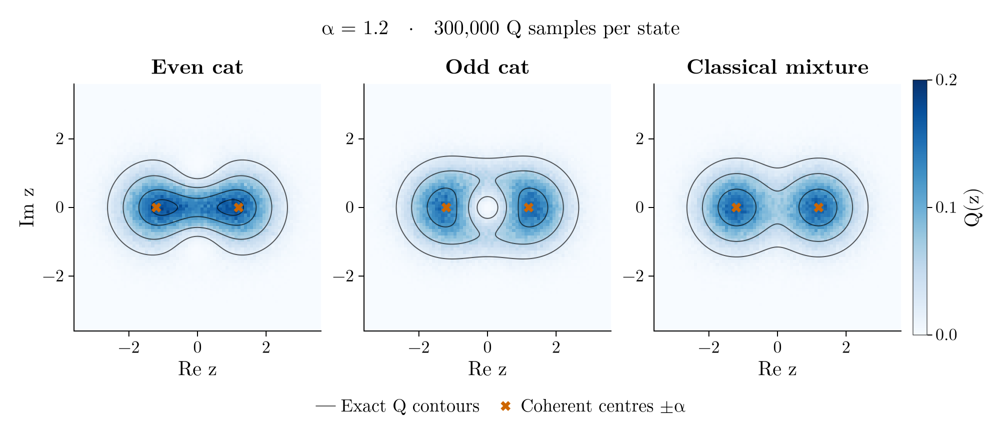

# PhaseSpaceTools

[](https://AshtonSBradley.github.io/PhaseSpaceTools.jl/dev)
[](https://github.com/AshtonSBradley/PhaseSpaceTools.jl/actions)
[](https://github.com/AshtonSBradley/PhaseSpaceTools.jl/actions/workflows/Aqua.yml)
[](https://codecov.io/gh/AshtonSBradley/PhaseSpaceTools.jl)
[](https://zenodo.org/badge/latestdoi/115932136)

Sample quantum initial states commonly encountered in quantum phase space simulations of Bose fields, including those encountered in quantum optics and Bose-Einstein condensates. 

Exact Husimi-Q and positive-P sampling includes cats, finite quantum superpositions, photon-added states and multimode initial conditions. Ordinary Wigner sampling is available for the states listed in the support table.

Available distributions are `glauberP`, `positiveP`, `wigner`, `positiveW`, and `husimiQ`.

[](docs/src/cat-q.md)

Even and odd cats preserve different interference between the same coherent
components at ±α. [Explore the cat-state Q tutorial](docs/src/cat-q.md).

## Install

```julia
julia> ]add PhaseSpaceTools
```

## Quick Start

```julia
using PhaseSpaceTools, Random

rng = MersenneTwister(42)
α = 1.2 + 0im
state = EvenCat(α)                  # |α⟩ + |−α⟩, normalised
z, zbar = husimiQ(rng, state, 100_000)
```

`z` contains Q phase-plane samples and `zbar == conj.(z)`. Use `OddCat(α)` for
the relative minus sign. The classical mixture is
`Mixture((Coherent(α),Coherent(-α)),[0.5,0.5])`. The
[tutorial](docs/src/cat-q.md) compares all three distributions and explains
`sampleQ(...; diagnostics=true)`, ordering corrections and preparation loss.

## Core states

- `Bogoliubov`
- `Coherent`
- `Crescent`
- `Fock`
- `Squeezed`
- `SqueezedTwoMode`
- `Thermal`

Exact Q extensions include cats and finite coherent/Fock superpositions, NOON
states, photon-added and photon-subtracted families, passive multimode states,
fixed-number condensates, Gaussian covariance states, and loss/phase-diffusion
channels. All inherit exact positive-P sampling. See the
[state × representation table](docs/src/support.md) for the full API and its
exact/approximate/unsupported distinctions.

### Coherent state
A coherent state |α⟩ is sampled as
```julia
α = 1.0+im*2.0 # coherent amplitude
s = Coherent(α) # define state |α⟩
N = 1000 # number of samples
a,a⁺ = positiveP(s,N)
```
This is a special case where the two phase space variables `a` and `a⁺` are complex conjugate, and non-stochastic in the `+P` representation.

### Fock state
An approximate Fock state sampler in the Wigner representation:
```julia
n = 100
s = Fock(n) # define number state |n⟩
N = 1000 # number of samples
a,a⁺ = wigner(s,N)
```
Provides an approximate sampling of `W` that reproduces operator averages for large `n`. For every `n>0` this is explicitly an approximation, useful when `n ≫ 1`. `Fock(0)` uses the exact vacuum Gaussian.

## Examples

See [`examples/exact_sampling.jl`](examples/exact_sampling.jl) for seeded examples
of cats, photon addition, NOON states, fixed-number condensates and preparation
loss. All samplers accept an explicit RNG as their first argument. `sampleQ`
always returns a modes × samples matrix; historical single-mode vectors and the
legacy two-mode four-vector interfaces remain available.

- [Kerr evolution](examples/kerr_evolution.jl) samples a coherent input at
  collapse and revival times using finite Fock superpositions.
- [Canonical thermal states](examples/canonical_thermal.jl) sample Gibbs
  mixtures for Kerr, harmonic and displaced harmonic oscillators.
- The [worked Fock-basis examples](docs/src/fock-basis.md) explain the
  estimators and checks used in these examples.

The [support table](docs/src/support.md) distinguishes exact laws, explicit
approximations and unsupported methods. Positive-W is a doubled representation,
with generally correlated nonconjugate coordinates, and is not ordinary W.
Gaussian covariances use `[x,p]=i` and vacuum `I/2`; divide an `[X,Y]=2i`
covariance by two before using `Gaussian`.

Development evidence and outstanding limitations are recorded in
[`dev/PROGRESS.md`](dev/PROGRESS.md).

# External links
___Numerical representation of quantum states in the positive-P and Wigner representations,___ \
M K Olsen, A S Bradley, \
[Optics Communications 282, 3924 (2009)](http://dx.doi.org/10.1016/j.optcom.2009.06.033)

[Scipost Commentary with full erratum](https://scipost.org/commentaries/10.1016/j.optcom.2009.06.033/)
