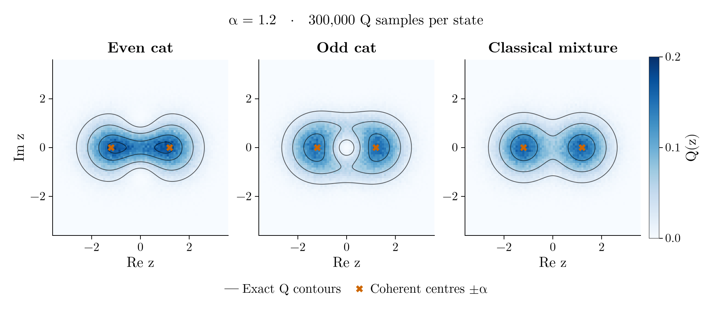
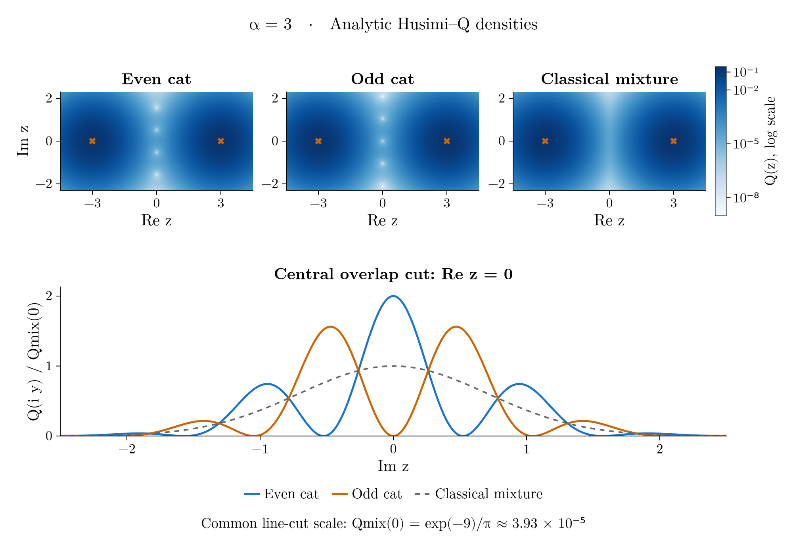
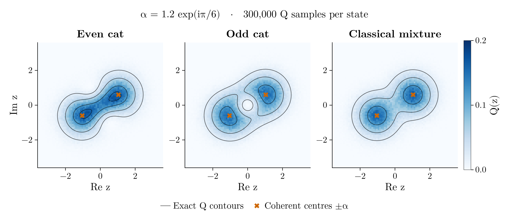

# [Cat states by rejection sampling](@id cat-q-tutorial)

This worked example applies the rejection method introduced in
[Exact Q Sampling](exact-sampling.md) to a coherent superposition. The Gaussian
proposal samples a classical mixture; the acceptance step produces the cat's
interference. We compare the resulting Q samples, then check their moments and
acceptance rates.

A cat state coherently combines two coherent states centred at opposite complex
amplitudes, **+α and −α**. The relative sign distinguishes even and odd cats:

```math
|C_\pm\rangle =
\frac{|\alpha\rangle\pm|-\alpha\rangle}
{\sqrt{2(1\pm e^{-2|\alpha|^2})}}.
```

`EvenCat(α)` chooses the plus sign; `OddCat(α)` chooses the minus sign. Both
contain the same two coherent components. Their interference gives different
Husimi-Q distributions, which this package samples exactly without a Fock cutoff.

## Compare even, odd and classical states



*Each panel uses 300,000 seeded Q samples at α=1.2. Colour shows a normalised
sample histogram; black contours show the independent analytic Q density at
0.02, 0.06, 0.12 and 0.16. Orange crosses mark the coherent-component centres
±α, which need not coincide with the maxima of the full Q distribution. All
panels share axes, bins and a colour scale. [Download PDF](assets/cat-q.pdf).*

The even cat has enhanced density between the components. The odd cat has an
exact Q node at the origin. The equal classical mixture has no interference
term. A histogram averages over finite bins, so its central bins need not be
exactly zero even when the analytic density vanishes at one point.

These axes are complex-amplitude coordinates, Re z and Im z. In the package's
quadrature convention `z=(x+ip)/√2`; the alternative convention uses
`z=(X+iY)/2`, with `X=√2x`, `Y=√2p`. See
[General Gaussian states and quadrature units](@ref).

## [Larger cats: locating weak Q interference](@id cat-q-fringes)

For **real α=3**, an ordinary Q plot is dominated by two Gaussian-like peaks
near **z=±3**. The interference lies in the much weaker central region around
**Re z=0**, varying along Im z. A plot through either coherent peak is a
different cut and will not resemble the central interference profile. The
relative fringe contrast falls as `sech(2α Re z)`, giving a characteristic
transverse scale `1/(2α)`, about 0.17 here. This is a thin strip between lobes
separated by six amplitude units.



*Top: the full Q functions on a shared **linear** colour scale over
−5.5≤Re z, Im z≤5.5. The coherent peaks are near ±3. Dotted segments mark the
central line cut shown below. Bottom: that cut in **raw Q units**, with a
separate vertical range reaching only about 8×10⁻⁵. The main peaks above
reach about 0.159. [Download PDF](assets/cat-q-interference.pdf) ·
[Raw line-cut data](assets/cat-q-interference-cut.tsv).*

The large-cat Q functions look almost identical on this full linear scale.
For the even cat, Q(0)≈7.86×10⁻⁵ is only **0.049% of the main-peak height**.
The detail panel makes this very small central structure visible; it does not
represent the height or dominant shape of the full distribution.

The oscillations can also be located in a [logarithmic diagnostic view](assets/cat-q-interference-log.png)
([PDF](assets/cat-q-interference-log.pdf)). That view uses a colour floor of
10⁻⁹ and divides its central line cut by the explicitly labelled constant
Qmix(0)=exp(−9)/π≈3.93×10⁻⁵. This increases the cut's plotted height by about
25,500. It is a magnified diagnostic, so its appearance differs substantially
from an ordinary linear Q plot.

For real α, set `A=α²` and `z=iy`. The exact central cuts are

```math
\begin{aligned}
Q_+(iy)&=\frac{2e^{-A-y^2}\cos^2(\alpha y)}{\pi(1+e^{-2A})},\\[4pt]
Q_-(iy)&=\frac{2e^{-A-y^2}\sin^2(\alpha y)}{\pi(1-e^{-2A})},\\[4pt]
Q_{\mathrm{mix}}(iy)&=\frac{e^{-A-y^2}}{\pi}.
\end{aligned}
```

The oscillatory factors have period Δy=π/α. Larger amplitudes pack more fringes
into the central region, while the absolute density there falls as exp(−α²).
Q remains nonnegative: the interference appears as small positive lobes and
nodes. For the Q definition and the significance of its zeros, see
[Teh et al., Appendix A](https://arxiv.org/pdf/1910.01298).

### Compare coordinate conventions

These figures use the density with respect to `d(Re z) d(Im z)`. If your plot
uses quadrature coordinates, both the positions and the density per coordinate
area change:

| Axes | Coordinate relation | Coherent centres for α=3 | Density in those coordinates |
|:--|:--|:--|:--|
| u=Re z, v=Im z | z=u+iv | (±3,0) | Q(z) |
| x,p | z=(x+ip)/√2 | (±3√2,0) | Q(z)/2 |
| X,Y | z=(X+iY)/2 | (±6,0) | Q(z)/4 |

The density factors are the Jacobians of these coordinate changes. For a
complex α, the two centres rotate with α and the interference cut must rotate
with them. With unit direction `e=α/abs(α)`, the corresponding central cut is
`z=i e y`.

The figures use analytic coherent overlaps without a Fock cutoff. Validation
compares the central cuts and a two-dimensional grid over the entire displayed
square against an independent 80-level Fock calculation. The coherent-state
omitted tail in that validation is below 10⁻⁴⁰. These analytic views do not
claim that a modest sample histogram resolves the very weak central fringes.

## Draw Q samples

Choose the coherent amplitude, state and an explicit RNG:

```@example cat_q
using QuantumPhaseSpace, Random, Statistics

rng = MersenneTwister(42)
α = 1.2 + 0im
N = 100_000

even = EvenCat(α)
odd = OddCat(α)
mixture = Mixture((Coherent(α), Coherent(-α)), [0.5, 0.5])

z, zbar = husimiQ(rng, even, N)
println(length(z), " samples; conjugate coordinates: ", zbar == conj.(z))
```

Each `z` is one point in the ordinary Q phase plane. The second returned vector
is its complex conjugate. `sampleQ` provides the same distribution in the common
**modes × samples** layout and can report rejection diagnostics:

```@example cat_q
Zeven, de = sampleQ(rng, even, N; diagnostics=true)
Zodd, do_ = sampleQ(rng, odd, N; diagnostics=true)
Zmix, dm = sampleQ(rng, mixture, N; diagnostics=true)

@assert size(Zeven) == (1, N) # hide
(even=round(acceptance_rate(de); digits=4),
 odd=round(acceptance_rate(do_); digits=4),
 mixture=acceptance_rate(dm))
```

`vec(Zeven)` gives the single-mode sample vector. The matrix layout also applies
to multimode states. A complete batch is returned on success; a rejection sampler
that exhausts `max_attempts` raises a `SamplingError` with its proposal counts.

## How the sampler preserves interference

For the amplitude in the figure, both cats use the direct two-Gaussian proposal:

1. Choose +α or −α with equal probability.
2. Draw `z = ±α + ξ`, with `ξ ~ CN(0,1)` and `E[abs2(ξ)]=1`.
3. Accept the proposal with the interference-dependent probability

```math
p_{\mathrm{acc},\pm}(z)=\frac12\left[
1\pm\frac{\cos\!\left(2\operatorname{Im}(\alpha^*z)\right)}
{\cosh\!\left(2\operatorname{Re}(\alpha^*z)\right)}\right].
```

The Gaussian proposal by itself samples the classical mixture in the third
panel. Rejection supplies the coherent interference for the first two panels.
The exact mean acceptance of this proposal is

```math
\mathcal A_\pm=\frac{1\pm e^{-2|\alpha|^2}}2.
```

At α=1.2 this is approximately 0.5281 for the even cat and 0.4719 for the odd
cat. The mixture accepts every direct draw. The observed rates above fluctuate
around these targets. The implementation evaluates the hyperbolic factor
stably; samples are drawn over the entire complex plane.

For reference, writing `A=abs2(α)`, the plotted analytic densities are

```math
\begin{aligned}
Q_\pm(z)&=\frac{
 e^{-|z-\alpha|^2}+e^{-|z+\alpha|^2}
 \pm2e^{-|z|^2-A}\cos\!\left(2\operatorname{Im}(\alpha^*z)\right)
}{2\pi(1\pm e^{-2A})},\\[6pt]
Q_{\mathrm{mix}}(z)&=\frac{e^{-|z-\alpha|^2}+e^{-|z+\alpha|^2}}{2\pi}.
\end{aligned}
```

All are nonnegative and normalised on the complex plane. The figure generator
checks these densities independently of the sampler's overlap implementation.
Its histogram uses the **total** number of samples for normalisation, including
samples outside the displayed square; no distribution is conditioned on the
plotting window.

## Check the sampled moments

Q moments are antinormally ordered. In particular,
`mean(abs2, z)-1` estimates the occupation. The correction is one:

```math
\mathbb E_Q[|z|^2]=\langle n\rangle+1,
\qquad \mathbb E_Q[z^2]=\alpha^2.
```

For the three states:

| State | Occupation ⟨n⟩ | Q density at the origin |
|:--|:--|:--|
| Even cat | A tanh(A) | 2 exp(−A) / [π(1+exp(−2A))] |
| Odd cat | A / tanh(A) | 0 |
| Equal mixture | A | exp(−A) / π |

The second complex moment is the same for all three states; it checks the
amplitude and phase convention. Occupation and the central Q density reveal
the distinction between these states. For the even-cat samples:

```@example cat_q
A = abs2(α)
number_samples = abs2.(z) .- 1
estimate = mean(number_samples)
standard_error = std(number_samples) / sqrt(N)
target = A * tanh(A)

@assert abs(estimate-target) < 6standard_error
(estimated_occupation=round(estimate; digits=4),
 exact_occupation=round(target; digits=4),
 standard_error=round(standard_error; digits=4))
```

The figure validation also checks both parts of the complex first and second
moments, density normalisation, the probability in the central interference
region, and acceptance at six standard errors. The measurements for all six
panels are available as [tab-separated validation data](assets/cat-q-validation.tsv).

## Complex amplitudes and relative phases

A complex α rotates the line joining the component centres. Here the amplitude
has the same magnitude as before and a phase of π/6:

```@example cat_q
αrot = 1.2cis(π/6)
rotated_even = EvenCat(αrot)
zrot, _ = husimiQ(rng, rotated_even, N)
@assert length(zrot) == N # hide
nothing # hide
```



*The same comparison with α=1.2 exp(iπ/6), independent seeded samples, and the
same density scale and coordinate limits. The component centres rotate with α.
[Download PDF](assets/cat-q-rotated.pdf).*

The relative phase is a separate choice: `Cat(α, φ)` represents
`|α⟩ + exp(iφ)|−α⟩`, with the appropriate normalisation. It changes the
interference between the fixed components:

```@example cat_q
phase_cat = Cat(αrot, π/2)
Zphase = sampleQ(rng, phase_cat, N)
@assert size(Zphase) == (1, N) # hide
nothing # hide
```

## Include preparation loss

`Loss(cat, η)` applies the pure-loss channel, including decoherence. For Q,

```math
z_{\mathrm{out}}=\sqrt\eta\,z_{\mathrm{in}}+\sqrt{1-\eta}\,\xi,
\qquad \xi\sim\mathrm{CN}(0,1).
```

The environment noise is part of the channel. Simply reducing α in a pure-cat
constructor would retain pure-state coherence instead. Occupation scales by η:

```@example cat_q
η = 0.65
Zloss = sampleQ(rng, Loss(even, η), N)
loss_numbers = abs2.(vec(Zloss)) .- 1
loss_estimate = mean(loss_numbers)
loss_error = std(loss_numbers) / sqrt(N)
loss_target = η * A * tanh(A)

@assert abs(loss_estimate-loss_target) < 6loss_error
(estimated_occupation=round(loss_estimate; digits=4),
 exact_occupation=round(loss_target; digits=4))
```

## Small odd cats

As α approaches zero, the odd cat approaches the one-photon state. Its direct
Gaussian proposal becomes inefficient, so the implementation selects a different
exact proposal when it has better expected acceptance. That acceptance tends
to one. A small finite cat retains its exact finite amplitude:

```@example cat_q
small_odd = OddCat(0.05)
Zsmall, ds = sampleQ(rng, small_odd, N; diagnostics=true)
@assert size(Zsmall) == (1, N) # hide
round(acceptance_rate(ds); digits=4)
```

`OddCat(0)` is undefined; explicitly choose `Fock(1)` for the limiting state.
General relative phases close to destructive cancellation can also have low
acceptance. The [small-odd-cat derivation](@ref small-odd-cat)
explains the alternate proposal and its bound.

## Continue with other exact Q families

| Example | Constructor | What it demonstrates |
|:--|:--|:--|
| Photon-added thermal state | `PhotonAddedThermal(2, 0.7)` | Exact radial Gamma sampling |
| Photon-added coherent state | `PhotonAddedCoherent(1, 0.8+0.3im)` | A finite exact displaced Fock expansion |
| NOON state | `NOON(2; phase=π/3)` | Phase-sensitive two-mode coherence |
| Fixed-number condensate | `FixedNumberCondensate(20, [sqrt(0.3), sqrt(0.7)*cis(0.4)])` | A collective Fock mode with orthogonal vacuum modes |

See the [support table](support.md), [state constructors](states.md), and
[exact sampling derivations](exact-sampling.md). The executable
`examples/exact_sampling.jl` covers all of these families. Every supported Q
state also has positive-P initial sampling; estimator variance and subsequent
dynamical stability are separate questions from the exactness of Q generation.

## Regenerate the figures

From the repository root, in an existing Julia session:

```julia
using Pkg
Pkg.activate("examples")
Pkg.develop(path=".")
Pkg.instantiate()
include("examples/cat_q.jl")
CatQShowcase.make_cat_q_figures()
```

The script writes PNG/PDF sampled comparisons, the analytic large-cat fringe
view, and their validation tables under
`docs/src/assets`. It uses CairoMakie, 300,000 samples per state, and explicit
MersenneTwister seeds 4242 and 4243. The plotting range affects only the displayed
histogram; the samplers themselves have no spatial window.
