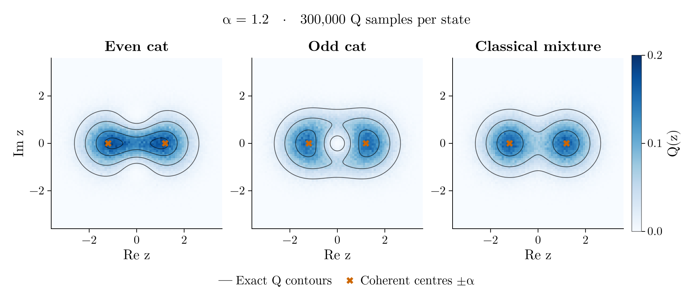

# Overview
This package provides sampling methods for commonly used quantum states in various quantum phase-space representations. These include Glauber-Sudarshan-P, Positive-P, Husimi-Q, and Wigner representations.

It also provides helpers for sampling complex and real noises used in phase-space simulations, including SDE workflows with [DifferentialEquations.jl](https://github.com/JuliaDiffEq/DifferentialEquations.jl).

## Start with a cat

Sample a coherent superposition of components centred at +α and −α. Even and
odd cats retain different interference, while a classical mixture averages the
two component densities. The [cat-state tutorial](@ref cat-q-tutorial) explains
the comparison, provides seeded code, and checks moments and acceptance.



# Installation
In the julia REPL

```julia-repl
julia> ]add PhaseSpaceTools

julia> ]test PhaseSpaceTools
```
# Reference
If you find this package useful, please cite

M. K. Olsen, A. S. Bradley, Numerical representation of quantum states in the positive-P and Wigner representations, [Optics Communications __282__, 3924-3929 (2009).](https://dx.doi.org/10.1016/j.optcom.2009.06.033)

A full erratum is given in this [SciPost Commentary.](https://scipost.org/commentaries/10.1016/j.optcom.2009.06.033/)
